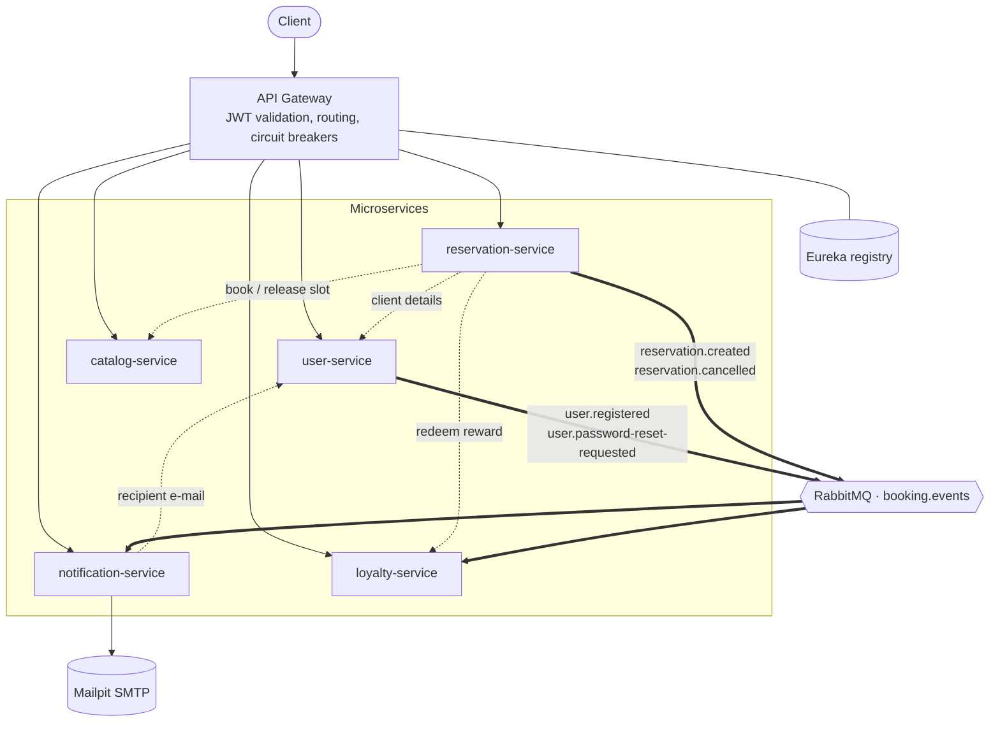

# Appointment Booking System

A microservices application for appointment booking and scheduling. The architecture consists of an API Gateway (Spring Cloud Gateway), a service registry (Eureka), a RabbitMQ message broker and five microservices built with Java and Spring Boot:

- **User Service** - accounts, authentication, activation, password reset
- **Catalog Service** - services on offer and their availability slots
- **Reservation Service** - bookings, cancellations, reward redemption
- **Notification Service** - notification templates and e-mail dispatch
- **Loyalty Service** - loyalty rules, appointment counters and rewards

Each service owns its own MySQL database and no service ever reads another service's schema. Synchronous calls between services go over REST (OpenFeign, load-balanced through Eureka); everything that does not have to be synchronous is an event on RabbitMQ.

## Architecture



Dotted lines are synchronous REST calls, thick lines are events.

## Overview

The system streamlines booking and managing appointments between clients and service providers. Clients register, browse what a provider offers, book a free slot and receive a confirmation by e-mail. Providers publish their services and availability, see who booked them, and can reward returning clients. Admins manage roles, access, and the text of every notification the system sends.

## Features

### User Service

- **User Types:** Supports multiple user roles (admin, client, provider) with specific privileges and data attributes.
  - **Admin:** All privileges, no additional attributes.
  - **Client:** Books appointments with providers.
  - **Provider:** Owns services and publishes the time slots they are available for.
- **Registration:** Clients and providers can register. Registration does not hand out a token - the account first has to confirm its e-mail address through an activation link. The admin role cannot be self-assigned; only an existing admin can grant it.
- **Activation:** The activation link carries a single-use token valid for 24 hours. Activating logs the user straight in, so there is no second step.
- **Login:** Users log in with email and password and receive a JWT. An unactivated account and an account disabled by an admin are refused with different messages - the user needs to know whether to look for an e-mail or to contact support.
- **Password reset:** A reset request always answers 202, whether or not the address is registered, so the endpoint cannot be used to discover which e-mail addresses exist. The reset token is single-use and valid for one hour.
- **Profile Management:** Users can retrieve their own profile; admins can list all accounts.
- **Access Control:** Admins can change any user's role, and revoke or restore access. An admin cannot disable their own account - the last admin would otherwise lock everyone out with no way back.
- **Initial admin:** Created on first start from `ADMIN_EMAIL`/`ADMIN_PASSWORD`. Without it no admin could ever exist, since the role is neither self-assignable nor grantable by anyone else.

### Catalog Service

- **Service Management:** Providers can create and update the services they offer, including duration and price. Deactivation is a soft delete, so existing reservations keep their history.
- **Slot Generation:** Providers can create individual slots or bulk-generate them for a date range, given working hours, service duration and an option to skip weekends. Generation is idempotent - re-running it will not duplicate existing slots.
- **Availability Listing:** Clients can browse slots with filters for service, time window and status. Browsing requires no authentication.
- **Booking:** Slots are marked as booked atomically using a pessimistic database lock, so two concurrent requests for the same slot cannot both succeed - the second one receives a conflict response.
- **Blocking:** Providers can block or unblock a slot without deleting it, and can delete slots that are still free.
- **Ownership Rules:** Only the provider who owns a service can modify it or its slots.

### Reservation Service

- **Booking:** Clients can book available slots, triggering a synchronous call to the Catalog Service that reserves the slot before the reservation is persisted.
- **Compensation:** If anything fails after the slot was taken - persisting the reservation, or redeeming a loyalty reward - a compensating action releases the slot and removes the half-finished reservation.
- **Cancellation:** Both the client and the provider of a booking can cancel it, which releases the slot back into availability.
- **Loyalty redemption:** A booking may spend an earned reward. The reward is validated before the slot is taken and confirmed after the reservation exists, because the Loyalty Service records which reservation consumed it.
- **Availability Check:** Clients can check whether a slot can still be booked before attempting to book it.
- **Booking History:** Clients can list their own reservations and providers can list the reservations booked with them, both paginated.
- **Client Details:** Providers can retrieve the contact details of the client who made a booking, fetched from the User Service over REST.

### Notification Service

- **Notification Types:** Admins can define, update, deactivate and delete notification templates. The text carries named parameters in double curly braces, and a template's parameter list is derived from its text on every save, so an admin can see what each one expects. A preview endpoint renders a template with test values before any client sees it.
- **Activation Email:** Sent when a user registers.
- **Password Reset Email:** Sent when a reset is requested.
- **Booking Confirmation:** Sent to the client and to the provider when a slot is booked, each from its own template.
- **Cancellation Notification:** Sent to both parties, naming who cancelled.
- **Inbox:** Every dispatched notification is stored with its rendered text, so users can read what they were sent and admins can audit it. The stored copy is the text as it was sent - editing a template later does not rewrite history.
- **Retry and dead-letter:** Transient failures (SMTP down, user-service restarting) are retried with exponential backoff. A message that can never succeed - a template asking for a parameter the event does not carry - is rejected straight onto a dead-letter queue instead of burning retries.
- **Idempotent consumption:** A unique constraint over (event, template, recipient) means a redelivered message re-sends rather than duplicating a notification.

### Loyalty Service

- **Loyalty Rules:** Providers define a rule - "every Nth appointment earns ⟨reward⟩, valid M days". A provider has at most one active rule at a time, because a single counter cannot unambiguously serve two thresholds. Rules are publicly readable, so a visitor can see what a provider rewards before signing up.
- **Counters:** Maintained purely from reservation events; the service never reads the Reservation Service's database. Issuing a reward subtracts the threshold rather than resetting the counter, so appointments past the threshold carry over instead of being lost.
- **Rewards:** Issued with the rule's description copied in, so a later edit to the rule cannot change what a client was already promised. Clients see their own counters and rewards; providers see which of their clients are close to one.
- **Redemption:** Synchronous, so the outcome is known while the booking is still in progress and one reward cannot be spent twice. Cancelling a booking that used a reward releases the reward back to the client.
- **Idempotent consumption:** Processed event ids are recorded in the same transaction as the counter change, so a redelivered message cannot inflate a counter and hand out an unearned reward.

### API Gateway

- **Single Entry Point:** All external traffic is routed through the gateway; the microservices are not exposed directly.
- **Authentication:** The JWT is validated in one place. The gateway strips any identity headers sent by the client and injects the verified user id, email and role for the downstream services.
- **Internal API Protection:** Service-to-service endpoints (`/api/internal/**`) are blocked at the gateway and are only reachable from inside the container network.
- **Resilience:** Circuit breakers return a fallback response instead of leaving the caller hanging when a service is unavailable.

## Technologies Used

- **Frameworks/Libraries:** Spring Boot 3.3, Spring Cloud Gateway (API Gateway), Eureka (Service Discovery), Spring Cloud LoadBalancer, OpenFeign, Resilience4j, Spring AMQP (RabbitMQ), Spring Security, Spring Data JPA, jjwt (JWT), springdoc-openapi (Swagger)
- **Tools:** Java 21, MySQL 8 (a separate database per service), RabbitMQ, Mailpit (local SMTP), Docker & Docker Compose, Kubernetes, Maven, JUnit 5, Mockito, AssertJ

## Running it

### Docker Compose

```bash
cp .env.example .env     # then change JWT_SECRET and ADMIN_PASSWORD
docker compose up --build -d
```

| What | Where |
|---|---|
| API Gateway (entry point) | http://localhost:8080 |
| Eureka dashboard | http://localhost:8761 |
| Mailpit - every e-mail the system sends | http://localhost:8025 |
| RabbitMQ console | http://localhost:15672 |
| Swagger UI per service | http://localhost:8081/swagger-ui.html … `8085` |

`make help` lists the shortcuts. [api-examples.http](api-examples.http) walks through the whole system - registration, activation, booking, loyalty, notifications - and works in the IntelliJ HTTP Client or the VS Code REST Client.

If port 8080 is taken on your machine, set `GATEWAY_PORT` in `.env` and change `ACTIVATION_BASE_URL`/`PASSWORD_RESET_BASE_URL` to match, so the links in the e-mails keep working.

### Kubernetes

The manifests in [k8s/](k8s/) deploy the same images Compose builds: one namespace, a ConfigMap and a Secret for configuration, five MySQL StatefulSets with their own volumes, RabbitMQ, Mailpit, the registry, the gateway (2 replicas) and the five services - each with startup, readiness and liveness probes and resource limits.

```bash
make k8s-images          # build the images into the local Docker daemon
make k8s-up              # kubectl apply -k k8s/ and wait for every rollout
make k8s-status          # pods, services, volume claims
make k8s-forward         # gateway on :8080, Mailpit on :8025, RabbitMQ on :15672
make k8s-down            # delete the namespace with everything in it
```

The manifests reference local images with `imagePullPolicy: IfNotPresent` and no registry. On Docker Desktop the cluster shares the Docker daemon, so `make k8s-images` is enough; on minikube run `make k8s-load-minikube` as well.

Only the gateway is reachable from outside - through the Ingress at `appointment-booking.local` (needs an ingress controller and a hosts entry) or through `make k8s-forward`. Mailpit and the RabbitMQ console are deliberately not exposed: they are development tools, and anything that can read other people's mail or the message bus has no business being reachable from outside the cluster.

Kubernetes has no equivalent of Compose's `depends_on`, so a service pod that starts before its database or the broker will fail and be restarted. That is what the startup probes are for: each pod gets roughly 150 seconds to come up before liveness checks begin, so restarts during the first minute of a cold cluster are expected rather than a symptom.

## Design decisions and known trade-offs

- **Events are published after commit, and a failed publish does not fail the request.** A registration or booking that is already stored must not be reported as an error because the broker was unreachable. The cost is at-most-once delivery: a lost event means a notification that never arrives. The fix would be an outbox table written in the same transaction and drained by a background job; with a single broker in a development cluster that was not worth the extra moving parts.
- **A slot released after cancellation can be left stranded** if the Catalog Service call fails once the cancellation has already committed. The failure is logged for reconciliation rather than retried inside the request, because that would make cancelling depend on another service being up.
- **Loyalty counts bookings, not completed appointments.** Nothing in the system marks an appointment as completed, so counting completions would mean rewards that never arrive. Cancellations decrement the counter, which keeps the number honest.
- **Loyalty rules apply per provider, not per service.** The cancellation event carries no service id, so a per-service counter could not be corrected when a booking is cancelled.
- **Reward expiry is evaluated when a reward is read or used,** not by a scheduled job rewriting rows. The status a client sees is correct either way, with one less moving part.
- **Eureka is kept in Kubernetes** even though Kubernetes has its own service discovery. Running the same mechanism in both environments means one behaviour to debug instead of two; a Kubernetes-only deployment could drop it and use Service DNS directly.
- **The values in `.env.example` and `k8s/02-secrets.yaml` are development credentials.** A Kubernetes Secret is base64-encoded, not encrypted; that file documents how to create the Secret out of band for anything real.

## Testing

```bash
make test          # or: mvn -B test
```

The suite covers the logic worth protecting: the booking saga and its compensations, concurrent-booking conflicts, the activation and password-reset token rules, template rendering, notification idempotency, and the loyalty counter and redemption rules.
